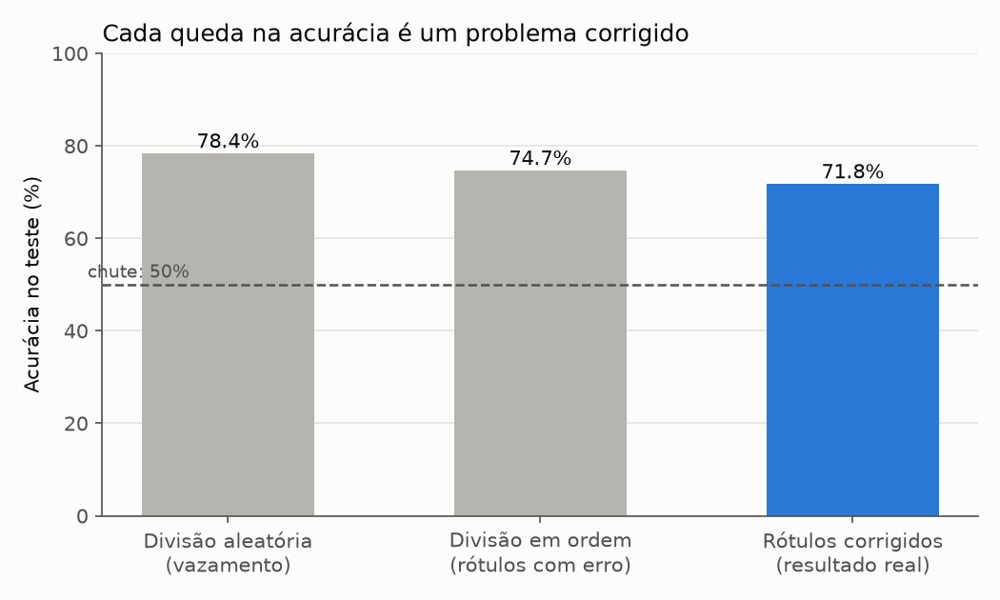
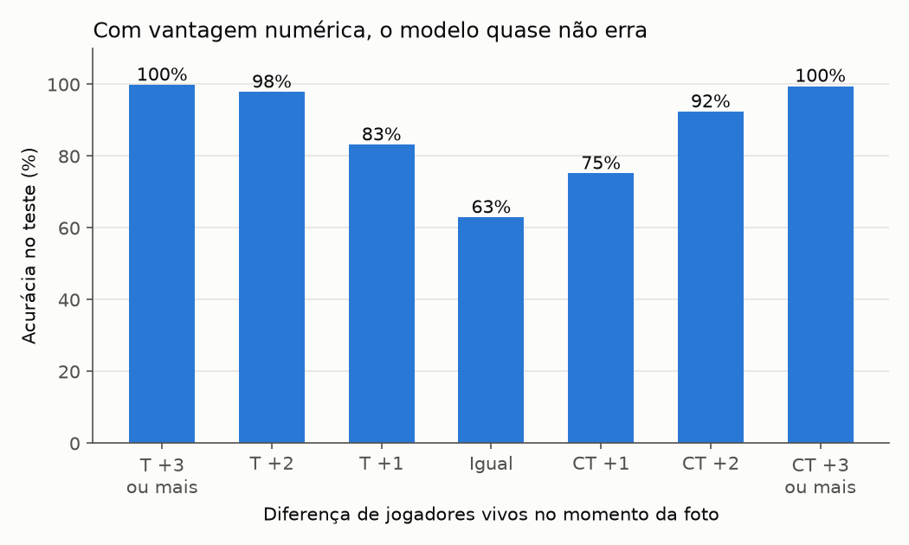
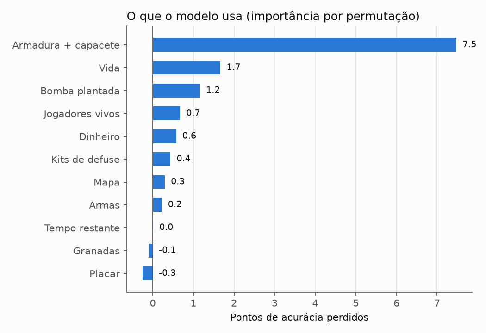
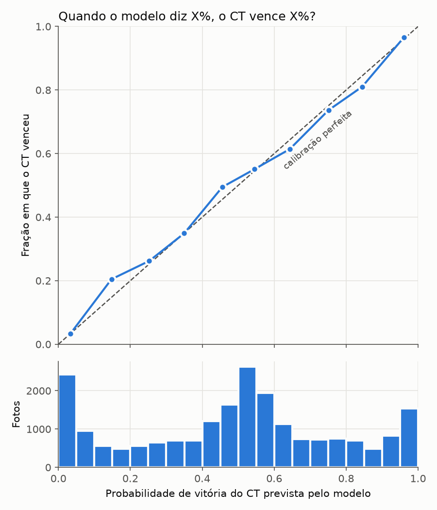
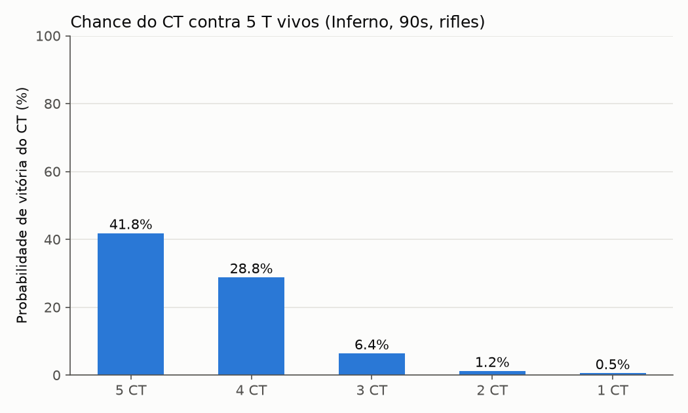

# Previsão do vencedor de rounds de CS:GO

Projeto da disciplina de IA: dado o estado de um round de CS:GO em um momento qualquer (tempo restante, jogadores vivos, vida, equipamento, bomba...), prever qual time vai vencer o round, Contra-Terroristas (CT) ou Terroristas (T), e com qual probabilidade.

**Resultado final:** 71,8% de acurácia em dados nunca vistos (o chute dá 50%), com probabilidades bem calibradas (Brier score 0,172, contra 0,250 do chute).

## Dados

[CS:GO Round Winner Classification](https://www.kaggle.com/datasets/christianlillelund/csgo-round-winner-classification) (Kaggle), arquivo `csgo_round_snapshots.csv`.

- 122.410 linhas e 97 colunas, sem valores faltantes.
- Cada linha é uma **foto** de um round em um momento (a cada ~20 s), não um round inteiro. Um mesmo round aparece várias vezes.
- O alvo é `round_winner` (`CT` ou `T`).

## Como rodar

```
py -m venv .venv
.\.venv\Scripts\python.exe -m pip install -r requirements.txt
.\.venv\Scripts\python.exe passo7_rotulos_e_momento.py
```

Todos os scripts rodam da mesma forma, a partir da pasta do projeto.

## Arquivos

| Arquivo | O que faz |
|---|---|
| `anselmo.py` | Exploração inicial: tamanho, tipos, distribuição do alvo, faltantes |
| `preparacao.py` | Módulo de apoio usado pelos outros scripts: leitura, conversão para números, separação treino/teste, engenharia de atributos e correção de rótulos |
| `passo2_preparacao_baseline.py` | Chute fixo e Regressão Logística |
| `passo3_comparar_modelos.py` | Regressão Logística x Random Forest x Gradient Boosting |
| `passo4_importancia.py` | Importância das variáveis por permutação em grupo |
| `passo5_engenharia_atributos.py` | Atributos novos (diferenças CT − T, valor do equipamento) com validação cruzada temporal |
| `passo6_demonstracao.py` | Modelo final + cenários inventados ("e se...?") |
| `passo7_rotulos_e_momento.py` | Correção dos rótulos e resultado final no teste |
| `passo8_calibracao.py` | Teste de calibração das probabilidades e Brier score |
| `passo9_rede_neural.py` | Comparação com redes neurais (aprendizado profundo) |
| `passo10_graficos.py` | Gera os gráficos da pasta `graficos/` |

> **Atenção:** os passos 2 a 5 usam os rótulos **originais** do CSV, antes da descoberta descrita no passo 7. Eles foram mantidos para mostrar a evolução do projeto, e suas notas ficam cerca de 3 pontos acima do resultado final.

## Metodologia e descobertas

### 1. Vazamento de dados na divisão treino/teste
Como cada round aparece em várias fotos, uma divisão **aleatória** coloca fotos do mesmo round no treino e no teste, e o modelo "reconhece" o round em vez de prever. Com divisão aleatória, a Random Forest chegou a 88,4% e o Gradient Boosting a 78,4%, números inflados. Por isso, todos os experimentos separam treino e teste **em ordem** (`shuffle=False`): os primeiros 80% para treino e os últimos 20% para teste.

### 2. Escolha do modelo
Com validação cruzada temporal (`TimeSeriesSplit`, 5 blocos, só dentro do treino), já com os rótulos corrigidos:

| Modelo | Validação |
|---|---|
| Regressão Logística | 72,0% |
| Random Forest | 72,3% |
| **Gradient Boosting** (`HistGradientBoostingClassifier`) | **72,3%** |
| Rede neural, 1 camada (64) | 68,7% |
| Rede neural, 2 camadas (128, 64) | 67,5% |
| Rede neural, 3 camadas (256, 128, 64) | 67,5% |

O Gradient Boosting empatou com a Random Forest e foi escolhido por ser mais rápido e decorar menos o treino (80% no treino contra 99,7% da Random Forest). As redes neurais perderam, o que é coerente com a literatura sobre dados tabulares (ver Referências).

### 3. Erro de rótulo na base
A **1ª foto** do período de compra (`time_left > 170`) após cada round já mostra o round novo (placar atualizado, todos vivos), mas o rótulo dela é o vencedor do round que **acabou de terminar**. Verificação nos casos em que o round anterior e o seguinte tiveram vencedores diferentes:

| Foto do período de compra | Rótulo = round anterior | Rótulo = próximo round |
|---|---|---|
| 1ª | 99,6% | 0,4% |
| 2ª e seguintes | ≤ 0,5% | ≥ 99,5% |

Essas fotos (~12% da base) são removidas por `limpar_rotulos` em `preparacao.py`. Antes da correção, o modelo ganhava pontos "prevendo o passado": a importância do dinheiro caiu de 2,3 para 0,6 ponto depois da correção.

A mesma investigação mostrou que, contando **rounds** (e não fotos), o CT vence 51,6% nesta base. Rounds vencidos pelo T geram mais fotos (7,2 contra 6,5 por round), o que inverte a proporção quando se contam linhas.

### 4. Resultado final (teste usado uma única vez)

| | Acurácia |
|---|---|
| **Geral** | **71,8%** |
| Período de compra (antes do round começar) | 55% |
| Round em andamento | 74% |





O limite de ~72% vem da informação disponível, não do modelo: cerca de 55% das fotos do teste são de momentos com todos os jogadores vivos, em que o resultado é realmente incerto. Com 2 ou mais jogadores de vantagem, a acurácia passa de 90%.

### 5. O que o modelo usa
Importância por permutação em grupo (queda na acurácia ao embaralhar cada grupo de colunas no teste):



Armadura + capacete domina, provavelmente por resumir o poder de compra do time (round completo x econômico). Vida e jogadores vivos aparecem abaixo do esperado porque são correlacionados: ao embaralhar um, o modelo compensa com o outro.

### 6. Calibração
Quando o modelo diz X%, o CT vence perto de X% das vezes (desvio máximo de 6 pontos por faixa):



### 7. Demonstração
`passo6_demonstracao.py` permite descrever uma situação e obter a probabilidade de vitória:



## Limitações e trabalhos futuros

- **O modelo não sabe quem está jogando.** A base não tem nome dos times, data nem ID da partida, então não é possível incluir força ou ranking dos times. É a maior limitação, especialmente no período de compra (55%).
- **Não há posição dos jogadores.** Trabalhos acadêmicos usam a posição de cada jogador no mapa, com redes neurais em grafo. Isso exigiria montar uma base nova a partir das demos das partidas.
- **Preços de equipamento aproximados.** Os preços usados em `preparacao.py` são aproximações e variaram entre atualizações do jogo.
- **Cenários inventados podem extrapolar.** Combinações raras na base (como dinheiro zero para os dois times) produzem probabilidades menos confiáveis.
- **Sem comparação com modelos comerciais.** Não é possível comparar com casas de aposta sem as odds dos mesmos momentos dos mesmos rounds.

## Referências

- Grinsztajn, L.; Oyallon, E.; Varoquaux, G. *Why do tree-based models still outperform deep learning on typical tabular data?* NeurIPS 2022 (Datasets and Benchmarks). arXiv:2207.08815.
- Shwartz-Ziv, R.; Armon, A. *Tabular data: Deep learning is not all you need.* Information Fusion, v. 81, 2022. arXiv:2106.03253.
- *Graph Neural Networks to Predict Sports Outcomes.* arXiv:2207.14124, 2022.
- *ESTA: An Esports Trajectory and Action Dataset.* arXiv:2209.09861, 2022.
- *Valuing Player Actions in Counter-Strike: Global Offensive.* arXiv:2011.01324, 2020.
